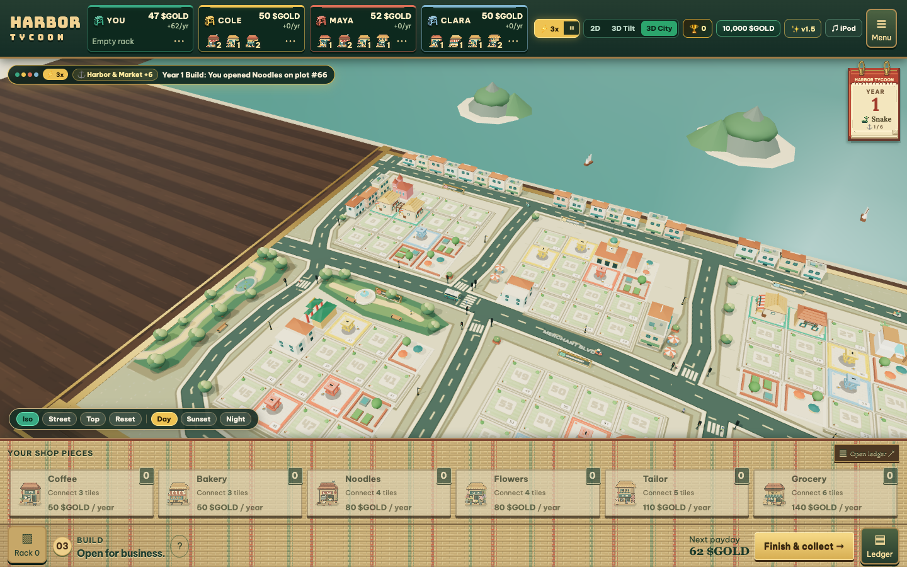
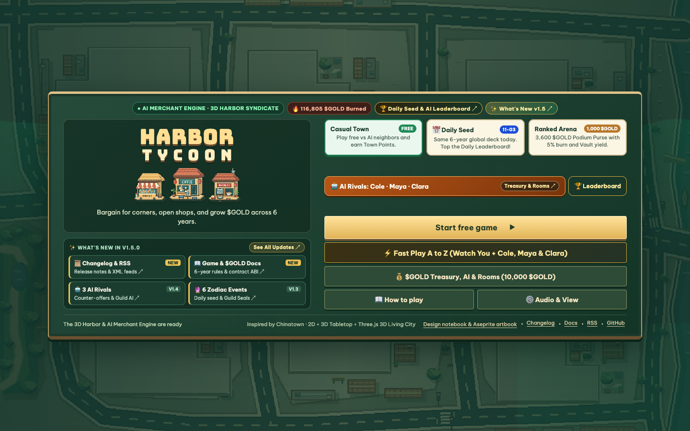
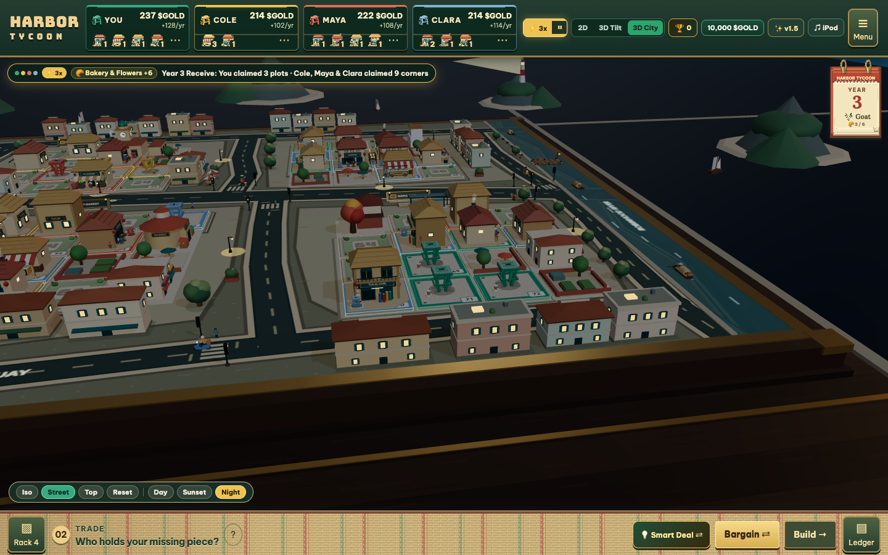
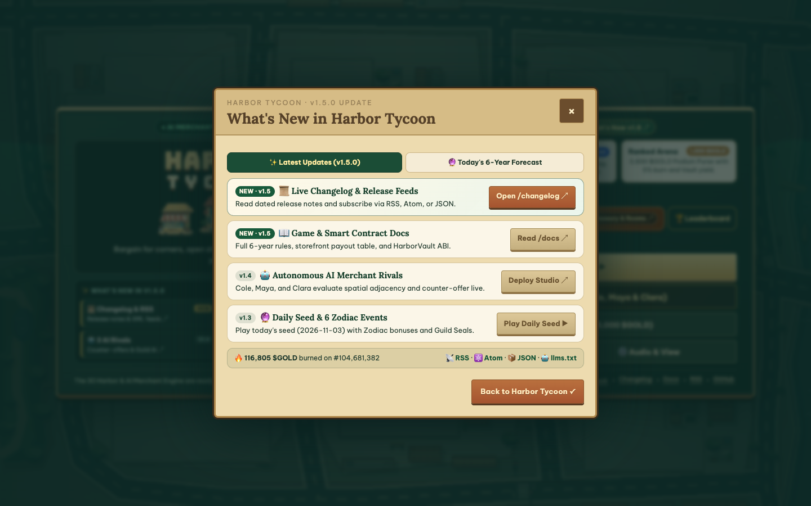
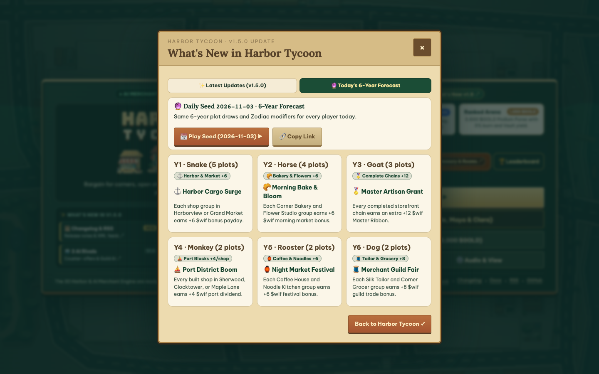
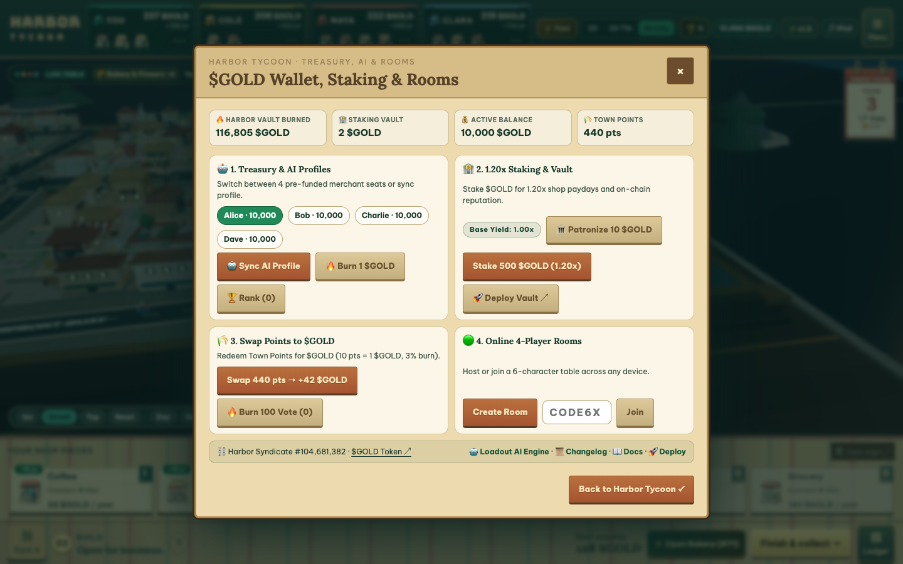
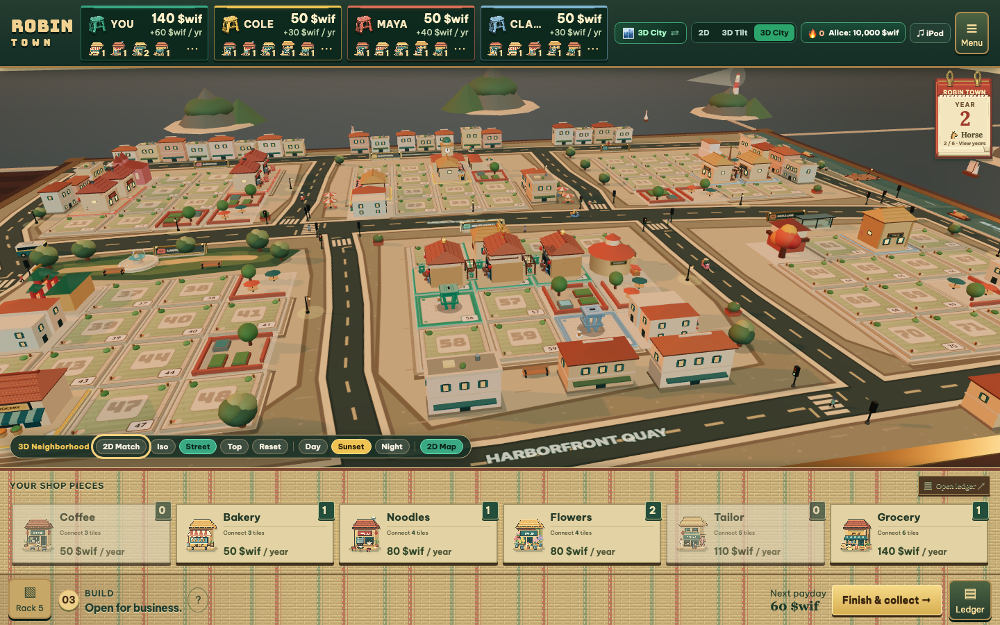

# Harbor Tycoon

**Live Playable Web Game**: [https://harbor-tycoon-production.up.railway.app](https://harbor-tycoon-production.up.railway.app)
**GitHub Repository**: [https://github.com/harrymove-ctrl/harbor-tycoon](https://github.com/harrymove-ctrl/harbor-tycoon)
**Competition**: [Loadout AI Game Competition (`https://app.loadout.xyz/jam`)](https://app.loadout.xyz/jam)
**Live Changelog & Syndicated Feeds**: [Changelog (`/changelog`)](https://harbor-tycoon-production.up.railway.app/changelog) · [RSS 2.0 (`/changelog.xml`)](https://harbor-tycoon-production.up.railway.app/changelog.xml) · [Atom 1.0 (`/atom.xml`)](https://harbor-tycoon-production.up.railway.app/atom.xml) · [JSON Feed (`/feed.json`)](https://harbor-tycoon-production.up.railway.app/feed.json)
**Web Game & Technical Docs**: [https://harbor-tycoon-production.up.railway.app/docs](https://harbor-tycoon-production.up.railway.app/docs)
**20s X Gameplay Clip (1080p MP4)**: [harbor_tycoon_loadout_jam_20s_clip.mp4](https://github.com/harrymove-ctrl/harbor-tycoon/releases/download/v1.5.0/harbor_tycoon_loadout_jam_20s_clip.mp4)
**Full 36s Gameplay Walkthrough (1080p MP4)**: [harbor_tycoon_loadout_jam_full.mp4](https://github.com/harrymove-ctrl/harbor-tycoon/releases/download/v1.5.0/harbor_tycoon_loadout_jam_full.mp4)

Harbor Tycoon is a browser-native 3D harbor diorama and street negotiation board game built for the **Loadout AI Game Competition**. Four merchants (`You`, `Cole`, `Maya`, and `Clara`, or up to 4 live human players across devices via 6-character WebSocket room codes) compete across 6 Zodiac Years (`Snake`, `Horse`, `Goat`, `Monkey`, `Rooster`, `Dog`) to draft 72 numbered street plots across 6 commercial districts, haggle open two-way OTC trades in `$GOLD`, construct connected shophouse chains, and harvest compounding annual dividends.



| Start Menu & Mode Select | 3D Lantern Night Atmosphere | What's New & Zodiac Forecast Hub |
| :---: | :---: | :---: |
|  |  |  |

| 6-Year Zodiac Forecast | `$GOLD` Treasury, AI & Online Rooms | 3D Sunset Harbor View |
| :---: | :---: | :---: |
|  |  |  |

## Core Gameplay & AI Merchant Engine

1. **Tactile 3D Harbor Diorama + Illustrated 2D Street Board**: Switch seamlessly at any second (`Hotkey V`) with zero state loss between a Three.js WebGL 3D Harbor Diorama (`Day`, `Sunset`, and `Lantern Night` lighting, connected multi-lot shophouse clusters, harbor cargo barges, and sidewalk traffic) and an illustrated `1100x730` Aseprite `2D` or `3D Tilt` tabletop board.
2. **Bilateral OTC Bargaining Table & AI Counter-Offers**: Trade any combination of `$GOLD` cash, empty street plots, built storefronts, and unplaced shop tiles. AI rivals (`Cole`, `Maya`, `Clara`) evaluate marginal cluster completion value (`ΔEV`), propose 1-click counter-offers (`Accept Counter ✓`) when a deal is close, and trigger Rival Monopoly Risk warnings before you hand an opponent a completed chain.
3. **Deterministic Daily Harbor Seed & 6 Zodiac Market Events**: Every UTC day generates an identical 6-year plot and shop draw across all players worldwide (`📅 Daily Seed`) paired with 6 permuted Zodiac Market Events (`Harbor Cargo Surge`, `Night Market Festival`, `Morning Bake & Bloom`, `Merchant Guild Fair`, `Master Artisan Grant`, `Port District Boom`) and `+15 $GOLD/yr` District Guild Majority Seals (`6+` plots in any 12-plot district).
4. **Fast Play `1x / 3x / 8x` A-to-Z Tabletop Simulation**: Watch or accelerate a full 6-year match (`Hotkey F`) with smart corner-adjacency drafting, autonomous bot-to-bot OTC bargaining, automatic shop placement, and a downloadable `1200x630` Year 6 Empire Score Card.
5. **Cross-Device WebSocket Multiplayer Rooms**: Create a 6-character room code (`CODE6X`) inside the `$GOLD` Treasury & Rooms modal or share a 1-click invite URL (`/?room=CODE6X`) over the zero-dependency RFC 6455 WebSocket relay (`/ws` and `/api/rooms`).

## How AI Contributed to Development

1. **AI Merchant Valuation & Counter-Offer Heuristics ([`src/town/engine.ts`](./src/town/engine.ts), [`src/town/trading.ts`](./src/town/trading.ts))**: AI assisted in designing and tuning the marginal cluster expected-value (`ΔEV`) evaluator, bot-to-bot bilateral swap solver, 1-click counter-offer generator (`proposeBotCounterOffer`), and rival monopoly risk detector (`detectRivalMonopolyRisk`).
2. **Procedural 3D Shophouse Architecture ([`src/town/city-3d/`](./src/town/city-3d))**: AI co-authored the procedural Three.js diorama kit (`procedural-kit.ts` and `robin-city-3d.ts`) that dynamically merges adjacent same-owner shop plots into unified multi-bay Southeast Asian shophouse terraces with rooftop monopoly monuments and animated harbor barges.
3. **Automated 100% English Sprite & Audio Synthesis ([`scripts/generate-english-saigon-assets.ts`](./scripts/generate-english-saigon-assets.ts), [`src/ui/audio.ts`](./src/ui/audio.ts))**: AI generated the pixel-art storefront icons, district plaques, `$GOLD` banknotes, and procedural Web Audio soundtrack controlled via the floating rotary click-wheel player.
4. **Adversarial Multi-Viewport QA Verification ([`verify_responsive_matrix.mjs`](./verify_responsive_matrix.mjs))**: AI built automated 9-viewport Playwright geometry and DOM overflow harnesses (`1920x1080` down to `375x667`) plus 934 unit and E2E tests verifying zero text clipping across desktop, tablet, and mobile viewports.

## Quick Start

```bash
npm install
npm run dev
```

Open `http://127.0.0.1:5173/` in your browser. To run the production HTTP and WebSocket server locally:

```bash
npm run build
npm start
```

## Verification and Testing

```bash
npm run verify:assets   # Verify all 69 declared PNG and SVG assets (zero 404s)
npm run typecheck       # Strict TypeScript type checking (tsc --noEmit)
npm test                # Run unit, integration, WebSocket, and E2E tests
npm run build           # Code-split production Vite bundle into dist/
```
